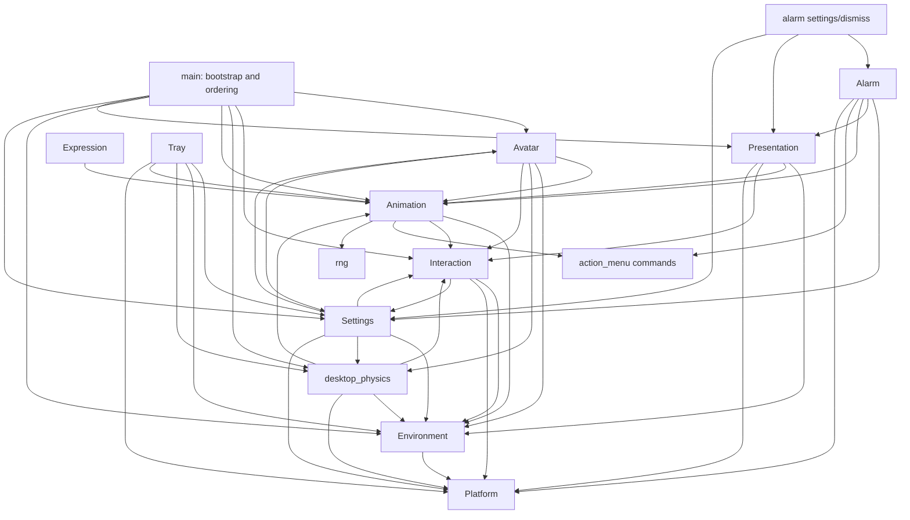

# Project Nera Architecture

This document describes the repository after Phase 5.9 and its module
consolidation. The current code is the source of truth. It focuses on ownership,
state flow, and ordering constraints
that are easy to break when changing a Bevy desktop pet with native Windows
integration.

## 1. Architecture overview

Project Nera is a Rust and Bevy desktop application whose primary Bevy window is
a transparent, undecorated avatar window. Most behavior is implemented as Bevy
resources, messages, components, and systems. Windows APIs provide global cursor
coordinates, native HWND movement, monitor/window discovery, taskbar data, tray
UI, and native utility windows.

The practical layers are:

1. **Bootstrap and orchestration** — `main.rs` creates the app, loads settings
   before creating the window, installs plugins/resources, and defines the
   cross-subsystem system chain.
2. **Desktop and native facts** — `platform` wraps Win32 calls; `environment`
   maintains the current HWND, monitor, taskbar, external-window, attachment,
   and projected avatar-anchor snapshot.
3. **Input and movement** — `interaction` classifies pointer gestures and owns
   click/drag capture. `desktop_physics` owns free-placement gravity and standing
   support. `environment::sitting` owns attached placement.
4. **Behavior and rendering decisions** — `animation` resolves the authoritative
   visual state and applies clips. `expression` derives the face from that visual
   state. `avatar` owns the VRM scene, gaze, and pose-derived anchors.
5. **Presentation and utilities** — `presentation` temporarily takes ownership
   of the main window for attention mode. `alarm`, settings, action-menu, alarm
   windows, and tray plugins coordinate through typed messages and resources.

This is not a strict one-way stack. Bevy resources provide shared coordination
points, especially `DesktopEnvironment`, `NeraAnimationState`, and
`PresentationState`. Those intentional relationships are documented below.

## 2. Module map

```text
src/
  main.rs
  avatar.rs + avatar/anchors.rs
  interaction.rs + interaction/{headpat,hit_testing}.rs
  animation.rs + animation/{state,systems,playback}.rs
  expression.rs
  environment.rs + environment/{taskbar,sitting}.rs
  desktop_physics.rs + desktop_physics/geometry.rs
  presentation.rs
  alarm.rs
  {action_menu,alarm_settings,alarm_dismiss}.rs  # Windows only
  animation_manager.rs + animation_manager/{registry,preview,ui}.rs  # Windows only
  settings/{mod,model,runtime,ui,shadow,startup}.rs
  tray.rs + tray/native.rs       # Windows only
  platform/{mod,windows}.rs
  rng.rs
```

### `src/main.rs` — bootstrap and cross-subsystem orchestration

- **Purpose:** Construct and run the Bevy app.
- **Owns:** Plugin registration, initial resources, primary-window defaults,
  asset-root selection, and explicit cross-subsystem schedules/run conditions.
- **Reads/depends on:** Every top-level plugin and the systems whose relative
  order affects interaction, physics, animation, gaze, and anchors.
- **Produces/emits:** The configured `App`; it does not define domain state.
- **Should NOT own:** Pointer rules, animation decisions, physics calculations,
  settings UI, avatar setup details, or Win32 implementation.

### `src/avatar.rs` and `src/avatar/anchors.rs` — avatar scene and pose-derived data

- **Purpose:** Create the camera/light/VRM avatar and translate its live pose
  into gaze and desktop-support information.
- **Owns:** `NeraAvatar`, `LookAtTarget`, `DeathVisualGrounding`, avatar spawning,
  gaze target updates, animation-aware gaze control, and skeleton projection.
- **Reads/depends on:** Assets and VRM components; `NeraSettings` for scale/gaze;
  `NeraAnimationState`; `DesktopPetInteraction`; `DesktopPhysicsState`; and
  `DesktopEnvironment`.
- **Produces/emits:** Camera/light/avatar entities; updated look-at target;
  `DesktopEnvironment.feet_anchor_logical` and `seat_anchor_logical`; refreshed
  physics support anchor after deliberate geometry changes; visual death-root
  correction.
- **Should NOT own:** Native attachment selection, pointer gesture state,
  animation assets/observers, animation priority, or freefall simulation.

`avatar.rs` creates the model, camera, light, and gaze target. It calls
`animation::spawn_animation_library()` to attach VRMA children to the model;
`animation/playback.rs` owns the avatar runtime clips' paths, load observers,
and registry. `alarm.rs` still spawns its alarm-specific VRMA children.
`avatar/anchors.rs` keeps pose projection and death grounding separate.

### `src/interaction.rs` and `src/interaction/` — semantic pointer interaction

- **Purpose:** Convert mouse/native cursor input and avatar hit tests into stable
  semantic interactions.
- **Owns:** `InteractionState`, `DesktopPetInteraction`, `HoveredBodyPart`,
  `HeadPatGesture`, `BodyPart`, colliders, and all `Nera*` interaction messages.
- **Reads/depends on:** Global cursor/platform data, `DesktopEnvironment`, avatar
  bones/camera, `NeraSettings`, and utility-window input gates.
- **Produces/emits:** `NeraClicked`, `NeraRightClicked`, `NeraDragStarted`,
  `NeraDragged`, `NeraReleased`, and `NeraHeadPatted`; native avatar-window moves;
  pending sitting requests through `DesktopEnvironment`.
- **Should NOT own:** Animation selection, freefall support, attention layout,
  or settings values.

File boundaries:

- `interaction.rs`: semantic message contracts, click/right-click capture,
  `Pressed -> Dragging` classification, window dragging, sitting/unsnapping
  handoff, click-through, and utility input gates.
- `hit_testing.rs`: avatar body colliders and nearest semantic body-part tests.
- `headpat.rs`: mouse-button-free head-stroke recognition and cooldown.

### `src/animation.rs` and `src/animation/` — animation state machine

- **Purpose:** Resolve all animation requests into one visual state and apply
  the corresponding VRMA clip.
- **Owns:** `NeraAnimationState`, animation vocabulary/priorities, clip handles
  and durations, playback cache, alarm-animation runtime, and idle scheduler.
- **Reads/depends on:** `DesktopEnvironment`; semantic interaction messages;
  alarm/action-menu commands; time; and `NeraRng`.
- **Produces/emits:** `VisualState`, base/support transitions, timed and persistent
  actions, the selected VRMA playback command, and the active attachment anchor.
- **Should NOT own:** Raw mouse handling, native window movement, alarm timing,
  facial override state, or settings persistence.

Submodule boundaries, in request-to-playback order:

- `systems.rs`: translates environment, interaction, alarm, and menu activity
  into state-machine requests; also schedules idle variation with cooldown,
  selection, and last-choice avoidance.
- `state.rs`: vocabulary, priorities, requests, locks/timers, damage combo,
  sitting transitions, and the authoritative `visual_state()` resolution.
- `playback.rs`: VRMA asset paths and child spawning, load observers, clip
  registry and measured durations, then `VisualState -> clip/repeat/blend/anchor`
  mapping and application. The avatar's runtime clip paths are here; alarm clip
  paths remain in `alarm.rs`.

### `src/expression.rs` — facial expression projection

- **Purpose:** Keep facial emotion consistent with the resolved body animation.
- **Owns:** `NeraExpressionState`, visual-to-expression mapping, crossfade state,
  quantization, and the emotion-preset allowlist.
- **Reads/depends on:** `NeraAnimationState::visual_state()` and VRM expression
  entities.
- **Produces/emits:** `SetExpressions` triggers before the VRM expression pass.
- **Should NOT own:** Independent reaction decisions or raw interaction readers.

### `src/environment.rs` and `src/environment/` — desktop snapshot and attached placement

- **Purpose:** Maintain the authoritative current view of Nera's native desktop
  surroundings and sitting attachment.
- **Owns:** `DesktopEnvironment`, `PlacementState`, window/taskbar attachments,
  discovered windows, tracked target state, monitor/taskbar data, anchor mode,
  and target-suspension visibility.
- **Reads/depends on:** `platform` Win32 queries, Bevy primary-window identity,
  timers, and pose-derived anchors written by `avatar`.
- **Produces/emits:** Refreshed Nera HWND/rect/DPI/monitor snapshot, external
  window snapshots, tracked target changes, taskbar state, pending/committed
  sitting placement, and attached-window following.
- **Should NOT own:** Gesture thresholds, animation priorities, or free-placement
  gravity.

File boundaries:

- `environment.rs`: `DesktopEnvironment`, periodic external-window discovery,
  and liveness, rect, minimize/cloak, and monitor tracking for the selected
  support window.
- `taskbar.rs`: taskbar geometry derived from monitor work areas.
- `sitting.rs`: support probing, pending-to-attached transition, follow behavior,
  suspension, z-order, detach, and attachment geometry.

`PlacementState` is the authoritative sitting/attachment state. Interaction and
animation observe or request transitions; they must not mirror it in new state.

### `src/desktop_physics.rs` and `src/desktop_physics/geometry.rs`

- **Purpose:** Simulate gravity and standing support while placement is `Free`.
- **Owns:** `DesktopPhysicsState`, vertical velocity, falling state, stable
  standing collision anchor, landing latch, subpixel motion, and `PhysicsSupport`.
- **Reads/depends on:** `DesktopEnvironment`, `DesktopPetInteraction`, animation
  clips/state, and platform movement/query functions.
- **Produces/emits:** Native vertical movement, support acquisition/loss, and
  falling/landing requests on `NeraAnimationState`.
- **Should NOT own:** Sitting attachments, pose sampling, pointer capture, or
  presentation transitions.

`geometry.rs` contains the pure support projection and crossing decisions used
by the runtime. The runtime deliberately freezes the standing support anchor
while falling/supported so moving animation bones do not move the collision body.

### `src/presentation.rs` — main-window presentation ownership

- **Purpose:** Switch the avatar between normal desktop-pet mode and attention
  presentation, currently used by alarms.
- **Owns:** `PresentationState`, `PresentationMode`, the desktop snapshot, entry
  progress, locked framing, and attention canvas/camera maintenance.
- **Reads/depends on:** `DesktopEnvironment`, animation and interaction state,
  avatar bones, platform monitor/window data, and the primary window/camera.
- **Produces/emits:** `PresentationCommand`, `PresentationEntered`, and
  `PresentationExited`; temporary native window/camera ownership; exact snapshot
  restoration on exit.
- **Should NOT own:** Alarm deadlines/audio, pointer gesture classification, or
  persistent settings.

Entering attention deliberately resets active pointer capture and suspends the
sitting animation/placement state. The saved placement and anchor are restored
when attention exits.

### `src/alarm.rs` and alarm utility modules

- **Purpose:** Schedule alarms, play/stop alarm audio, request attention, and
  coordinate alarm animation and dismiss UI.
- **Owns:** `AlarmState` (`Idle`, `Armed`, `Ringing`), `AlarmDisplayInfo`, custom
  schedule de-duplication, alarm assets/audio entities, and alarm VRMA bootstrap.
- **Reads/depends on:** Persistent alarm configuration, local platform time,
  action-menu commands, presentation lifecycle, and animation command messages.
- **Produces/emits:** `PresentationCommand`, `AlarmAnimationCommand`,
  `AlarmControlCommand` handling, looping audio, and due-alarm persistence updates.
- **Should NOT own:** Attention window layout, settings form state, or animation
  priority resolution.

Windows-only companion modules:

- `alarm_settings.rs` owns the multi-alarm editor window and draft UI state. It
  edits `NeraSettings` alarm records and queues persistence.
- `alarm_dismiss.rs` owns the dismiss/snooze panel, placement, and failsafe UI.
  It reacts to presentation lifecycle messages and sends presentation/alarm
  control commands.
- `action_menu.rs` owns the native radial menu lifecycle and typed
  `NeraActionMenuCommand` output. It opens settings/alarm settings and keeps the
  praying animation coupled to the real menu lifetime.
- `animation_manager.rs` owns the gallery window and input gate. Its registry
  scans physical VRMA files and persists bookmarks under AppData; its preview
  module creates independent VRM/VRMA instances only for cards near the scroll
  viewport. Desktop animation state and clip ownership remain in `animation`.

### `src/settings/` — persistent configuration and runtime application

- **Purpose:** Define, persist, edit, and apply user settings.
- **Owns:** `NeraSettings`, `AlarmConfig`, defaults, compatible alarm-book
  encoding, position/startup runtime, settings-window UI state, input gate,
  startup registration, and shadow implementation.
- **Reads/depends on:** Bevy settings persistence, primary window/audio/Winit,
  avatar transform, platform monitor information, environment/physics/interaction
  for shadow placement, and Windows startup APIs.
- **Produces/emits:** Runtime setting changes, deferred/synchronous saves,
  `OpenSettingsWindow`, `ReturnToActionMenu`, and settings-window entities.
- **Should NOT own:** Pointer state, attachment state, animation decisions, or
  alarm runtime phase.

Submodule boundaries:

- `model.rs`: authoritative schema, defaults, labels/value operations, and
  versioned alarm-book encoding/migration.
- `runtime.rs`: position recovery/recording, save helpers, and live application
  of always-on-top, size, audio, and FPS settings.
- `ui.rs`: settings window, controls, labels, scrolling, dragging, and input gate.
- `shadow.rs`: simple/character shadow entities and setting-driven updates.
- `startup.rs`: Windows startup registration read/write boundary.

The UI mutates the model; it is not the model. Preserve field meanings and the
current persistence representation when changing settings.

### `src/tray.rs` and `src/tray/native.rs`

- **Purpose:** Bridge a native Windows tray thread to Bevy-owned application
  state.
- **Owns:** Tray command channels, `TrayRuntime`, thread lifecycle, and command
  processing. `native.rs` owns the hidden HWND, icon/menu, callback procedure,
  Explorer restart handling, and Win32 message loop.
- **Reads/depends on:** Primary window, settings, environment, physics,
  animation, platform helpers, app exit, and action-menu result plumbing.
- **Produces/emits:** Show/hide/reset/toggle/exit actions and native action-menu
  callbacks delivered to Bevy through channels.
- **Should NOT own:** General desktop-window APIs, animation transitions, or
  settings schema.

Windows handles that cross the tray thread boundary are stored as atomic raw
values because the windows-rs `HWND` wrapper is not a Send/Sync Bevy resource.

### `src/platform/` — Win32 boundary

- **Purpose:** Provide native types and operations required by higher modules.
- **Owns:** HWND/monitor/rect/point wrappers; cursor, monitor, window, DPI,
  visibility, movement, z-order, discovery, and local-time functions.
- **Reads/depends on:** Windows APIs and the Bevy/winit bridge where necessary.
- **Produces/emits:** Plain platform facts and operation results.
- **Should NOT own:** Nera domain state, Bevy behavior decisions, settings, or
  animation/interaction semantics.

`windows.rs` is large but already bounded. Add a platform helper here when the
operation is generally native; do not spread direct Win32 calls into domain
modules without an existing native UI reason.

## 3. Dependency relationships

Arrows mean “reads, calls, or consumes state/messages from,” not ownership.



The apparent `avatar <-> environment/physics` cycle is a data pipeline, not
duplicate ownership: avatar pose sampling writes derived anchors into
`DesktopEnvironment`; environment/physics consume those anchors to position the
native window; avatar death grounding and anchor refresh then read their state.

Presentation also coordinates several modules directly. That coupling is
intentional because attention mode transfers ownership of the main HWND/camera
and must atomically suspend and restore placement, interaction, and animation.

## 4. State ownership

| State | Authoritative owner | Main readers/writers | Derived or transient state |
|---|---|---|---|
| Pointer capture and drag gesture | `interaction::DesktopPetInteraction` | `interaction.rs` writes; physics, anchors, presentation, shadow read/reset | Drag offsets, press body part, snap lock, unsnap guards |
| Hovered semantic body part | `interaction::HoveredBodyPart` | `update_click_through` writes; pointer/headpat/presentation read | Derived each hit-test pass from camera, bones, colliders, cursor |
| `Pressed -> Dragging -> Released` lifecycle | `InteractionState` plus `DesktopPetInteraction` | `drag_nera_window` is the transition owner | `NeraReleased` is a semantic message; state returns to `Hover` |
| Headpat recognition | `interaction::HeadPatGesture` | `detect_head_pat` writes; utility/presentation resets | Travel, reversals, timing, cooldown |
| Sitting/attachment | `environment::DesktopEnvironment.placement` | Pointer requests/detaches; sitting systems commit/follow; presentation snapshots/restores; animation observes | `PendingWindow`/`PendingTaskbar` delay native attachment until Seat sampling |
| Desktop/monitor/window snapshot | `environment::DesktopEnvironment` | Environment systems write; interaction, physics, avatar, presentation, settings shadow read | HWND rect/DPI, discovered/tracked windows, monitor, taskbars |
| Pose support anchors | `DesktopEnvironment.feet_anchor_logical` / `seat_anchor_logical` | `avatar::anchors` writes; sitting/physics consume | Screen projection of live avatar bones; feet may be deliberately frozen by physics |
| Freefall and standing support | `desktop_physics::DesktopPhysicsState` | Physics writes; tray resets; avatar refreshes support anchor; shadow reads | Velocity, support enum, subpixel Y, landing latch |
| Animation resolution | `animation::NeraAnimationState` | Animation systems, physics, presentation, tray write; playback/expression/avatar read | Base pose, active actions, transition timer, combo state, revision |
| Animation clips | `animation::NeraAnimationClips` | `animation/playback.rs` load observers write; systems/playback/physics read | Handles plus real loaded durations |
| Playback cache | `animation::NeraAnimationPlayback` | `apply_animation_state` only | Last applied visual/revision; not a behavior authority |
| Idle variation | `animation::IdleVariationRuntime` | `schedule_idle_variation` only | Cooldown, RNG, last action |
| Expression | `expression::NeraExpressionState` | Expression system writes from resolved `VisualState` | Previous/current face, crossfade, last pushed weights/entity |
| Presentation mode | `presentation::PresentationState` | Presentation systems write; alarm failsafe/run conditions read | Desktop snapshot and attention framing locks |
| Alarm phase | `alarm::AlarmState` | Alarm systems write; dismiss/failsafe query through messages/state | `Idle`, `Armed`, `Ringing`; audio entities carry a marker |
| Alarm display data | `alarm::AlarmDisplayInfo` | Alarm trigger updates; dismiss panel reads | Label and due time shown by UI |
| Persistent settings | `settings::NeraSettings` | UI/tray/alarm mutate; runtime/avatar/interaction/shadow/main read | Bevy SettingsPlugin-backed reflected resource |
| Settings input ownership | `settings::SettingsInputGate` and Windows `AlarmSettingsInputGate` | Utility-window systems write; interaction run conditions read | Prevents global mouse input leaking into the pet |
| Tray thread bridge | `tray::TrayRuntime` | Tray startup creates; Bevy update/action menu drain | Receivers and atomic hidden HWND; native message-loop state remains on its thread |

Do not add a second “is sitting,” “is dragging,” “current animation,” or “is in
attention” resource. Read the authoritative state above or introduce a semantic
message if a transition notification is required.

## 5. Event and message flow

### Pointer interaction

```text
platform global cursor + Bevy mouse input + live VRM pose
  -> interaction/hit_testing.rs computes semantic body part
  -> HoveredBodyPart and native cursor hit-test state
  -> interaction.rs captures press and classifies click vs drag
  -> NeraClicked / NeraRightClicked / NeraDragStarted / NeraDragged / NeraReleased
  -> animation/systems.rs requests reactions/floating
  -> action_menu.rs consumes right-click
  -> animation/state.rs resolves VisualState
  -> animation/playback.rs applies the clip
  -> expression.rs derives the face from the same VisualState
```

Headpat detection runs after hover/hit testing and emits `NeraHeadPatted` only
for a qualifying button-free head stroke. Animation translates that message into
a timed head-stroke action.

### Dragging and sitting

```text
Hover + left press
  -> DesktopPetInteraction::Pressed (body part and grab offset captured)
  -> DPI-scaled movement threshold
  -> Dragging + NeraDragStarted
  -> free HWND movement, or attached-surface unsnap
  -> held drag + seat probe + timing/anti-resnap guards
  -> DesktopEnvironment::PlacementState::Pending*
  -> animation observes a sitting surface and starts SittingEnter
  -> Last stage projects the animated Seat anchor
  -> settle_pending_sit commits Window/Taskbar attachment
  -> PreUpdate sitting follow keeps Seat aligned with support
```

Release emits `NeraReleased { was_dragging }`; animation removes persistent
`Floating` only for a true drag. Detachment is immediate during a pull-away so
cursor and HWND do not diverge while an exit clip plays.

### Free placement physics

```text
First/PreUpdate desktop snapshot refresh
  -> avatar feet anchor from the last eligible pose
  -> desktop_physics geometry finds desktop/taskbar/window support
  -> DesktopPhysicsState acquires, follows, loses, or crosses support
  -> native HWND vertical movement
  -> NeraAnimationState Falling/Landing requests
```

Physics yields entirely while `PlacementState` is not `Free`, while a real drag
owns movement, and during the special death grounding path.

### Alarm and attention

```text
action-menu preset or persistent alarm schedule
  -> AlarmState::Armed
  -> deadline reached
  -> looping audio + AlarmState::Ringing
  -> PresentationCommand::EnterAttention(Alarm)
  -> AlarmAnimationCommand::Start
  -> presentation snapshots desktop window/camera/placement
  -> interaction reset + support suspension + attention layout
  -> PresentationEntered
  -> alarm_dismiss panel appears
  -> Dismiss: PresentationCommand::ExitAttention
     or Snooze: stop audio + arm new deadline + exit attention
  -> presentation restores snapshot and emits PresentationExited
  -> alarm cleanup stops animation/audio and returns to Idle when applicable
```

The alarm-owned failsafe stops ringing if attention never becomes active. The
dismiss panel has a separate reachability failsafe because it is the user's
control surface.

### Settings

```text
SettingsPlugin loads NeraSettings before primary-window creation
  -> main reads start_hidden
  -> NeraSettingsPlugin initializes runtime/UI resources
  -> settings UI or tray mutates NeraSettings
  -> deferred save command
  -> chained runtime systems apply window/scale/audio/FPS changes
  -> dependent avatar, interaction, and shadow systems read the same resource
```

Position changes are recorded from `WindowMoved` and saved after a debounce.
Exit paths request synchronous save if settings changed. The alarm book remains
versioned string data inside the reflected settings schema for compatibility.

### Tray and native action menu

```text
tray/native.rs Win32 callback and message loop
  -> mpsc TrayCommand
  -> tray.rs process_tray_commands on Bevy main thread
  -> Window / NeraSettings / DesktopEnvironment / Physics / Animation updates

NeraRightClicked
  -> action_menu.rs posts a native message to the tray HWND
  -> native radial menu runs on the tray thread
  -> typed NeraActionMenuCommand result channel
  -> action menu republishes the command as a Bevy message
  -> animation, alarm, settings, or alarm settings consumes it
```

## 6. Scheduling and ordering constraints

Only explicit scheduling guarantees are listed. Separate plugin schedules may
run in Bevy's compatible order unless an explicit relation exists.

### Startup/bootstrap

- Persistent `NeraSettings` is loaded before `DefaultPlugins` creates the native
  window; `start_hidden` therefore determines creation-time visibility.
- Startup installs camera, light, and avatar spawning, plus plugin-owned startup
  systems for audio, tray, settings startup state, and shadows. There is no
  explicit cross-order among those independent startup systems.

### `First`

- `environment::sync_desktop_environment` refreshes the primary HWND, rect,
  monitor, DPI, and scale snapshot before normal frame logic.
- On Windows, the alarm-dismiss plugin also acquires its utility HWND in `First`
  because winit's HWND lookup must run on the main thread. No relative order is
  declared between these independent systems.

### `PreUpdate`

`DesktopEnvironmentPlugin` chains:

```text
refresh_window_snapshot
  -> track_target_window
  -> refresh_taskbars
  -> follow_sitting_attachment
```

The follower therefore sees current external-window and taskbar facts before it
moves or suspends an attached Nera.

### Main `Update` chain

`main.rs` explicitly chains:

```text
attach_bone_colliders
  -> update_look_at_target
  -> suspend interaction when a utility window owns input
  -> drag_nera_window [DesktopPet + utility input available]
  -> update_desktop_physics [DesktopPet]
  -> sync_environment_animation_state
  -> sync_interaction_animation_actions
  -> schedule_idle_variation [DesktopPet]
  -> tick_animation_actions
  -> sync_look_at_for_animation
  -> apply_animation_state
```

Consequences:

- Native drag/sitting requests happen before physics and animation resolution.
- Physics requests falling/landing before the final visual state is selected.
- Environment and interaction requests are resolved before idle scheduling.
- Idle is lowest priority and is requested before timers tick and playback runs.
- Animation-owned gaze is resolved before the clip is applied that frame.

Plugin-local `Update` chains also matter:

- `alarm.rs`: VRMA bootstrap -> menu/control consumption -> custom schedule ->
  deadline -> presentation-exit cleanup -> failed-attention abort.
- `presentation.rs`: debug request -> presentation command handling.
- `settings/mod.rs`: position restoration/record/save -> UI handling -> labels ->
  runtime application -> cleanup, all chained.
- `action_menu.rs`, `alarm_settings.rs`, and `alarm_dismiss.rs` each chain their
  native/UI lifecycle systems so open, action, close, and cleanup are ordered.

`animation::sync_alarm_animation` and the Windows action-menu animation bridge
are plugin-owned `Update` systems without an explicit cross-order against the
main chain. Preserve current message-based coupling unless a demonstrated bug
requires a new ordering constraint.

### `PostUpdate`

- `update_click_through` runs after `VrmSystemSets::SpringBone`, so body hit
  testing uses the evaluated pose. It runs only in desktop-pet mode with utility
  input available.
- `detect_head_pat` runs after `update_click_through` under the same conditions,
  so it consumes the current semantic hover.
- Expression driving runs before `VrmSystemSets::Expressions`, allowing its
  override to land in the same frame.
- Interaction logging is a debug consumer in `PostUpdate`; it does not own state.

### `Last`

`main.rs` chains:

```text
update_avatar_anchors -> settle_pending_sit [DesktopPet]
```

This is the pose-first sitting calibration: `SittingEnter` starts earlier,
anchors sample the evaluated pose, then the pending attachment commits using the
Seat anchor. Reversing this creates visible floating or snapping.

`presentation::maintain_attention_presentation` also runs in `Last`. It is the
final recurring owner of attention window/camera layout and intentionally
overrides earlier desktop attachment following. There is no explicit relative
order between it and the anchor/settle pair; run conditions and presentation
state prevent desktop settling from operating during attention.

## 7. Behavior-sensitive areas

| Area | Preserve | What can break |
|---|---|---|
| Pointer lifecycle | `Hover -> Pressed -> Dragging`, then release message and return to hover | Treating press as drag turns clicks into window movement and corrupts captured body parts |
| Drag threshold | DPI-scaled threshold in `interaction.rs` | Jitter becomes dragging, or deliberate drags become unresponsive |
| Pointer capture | Keep native hit-test enabled while a button owns the pet | Release goes to the window underneath, leaving state stuck |
| Utility input gate | Reset pet gesture state while settings/alarm settings owns input | Utility-window clicks leak into body hits or leave frozen capture |
| Sitting handoff | Pending placement -> SittingEnter -> Last-stage Seat sample -> commit | The avatar snaps using a standing/stale anchor or floats above support |
| Unsnap guards | Movement lock, cooldown, spatial guard, vertical band | Immediate re-snap loops or inability to pull Nera off a surface |
| Attachment ownership | Sitting owns placement when not `Free`; physics yields | Physics and attachment followers fight over the HWND |
| Taskbar/window support | Preserve physical desktop coordinates, target liveness, minimize/cloak, and z-order handling | Teleports, stale HWND reuse, invisible pet, wrong-monitor support |
| Standing anchor | Freeze collision anchor during falling/supported animation | Animated feet move collision geometry and cause jitter/repeated landings |
| Animation priority | Keep the ordering and one-shot/persistent semantics in `state.rs` | Idle/reactions can override death, physics, menu, or alarm |
| Animation completion | Use loaded clip duration, revision, repeat mode, and transition locks | One-shots restart, never finish, or resume stale tails |
| Sitting animation suppression | Suppress standing floating/fidgets while seated | Clips visually pull the avatar off its calibrated Seat anchor |
| Alarm interruption | Attention suspends placement/interaction/floating and restores snapshot | Alarm appears in the wrong pose or returns to stale dragging/sitting state |
| Presentation ownership | Snapshot and restore HWND, camera, placement, anchor, visibility, hit-test | Attention permanently changes desktop behavior or fights native followers |
| Expression integration | Derive from resolved `VisualState`; Neutral clears overrides | Face disagrees with body or blocks VRMA blink/look-at data |
| Settings persistence | Preserve reflected fields, defaults, alarm-book encoding, and load-before-window order | Existing profiles reset/migrate incorrectly or startup visibility flickers |
| HWND/native code | Keep raw handles validated and native calls on their required thread | Handle reuse, thread-safety violations, incorrect coordinates, native crashes |
| Tray loop | Keep Win32 callback work bridged through channels to Bevy | Blocking/deadlock, lost Explorer restart recovery, or domain mutation off-thread |

## 8. Where do I change X?

| Change needed | Start here | Also inspect |
|---|---|---|
| App/plugin registration or cross-system order | `src/main.rs` | Owning plugin schedule |
| Avatar model, camera, or lighting setup | `src/avatar.rs` | `animation/playback.rs` attaches animation children |
| Cursor-follow gaze | `src/avatar.rs` | `settings/model.rs`, animation visual states |
| Feet/Seat projection or death visual grounding | `src/avatar/anchors.rs` | `environment/sitting.rs`, `desktop_physics.rs` |
| Pointer press/click/drag/right-click behavior | `src/interaction.rs` | Message contracts in the same file; `hit_testing.rs` for body regions |
| Body-part hit detection/colliders | `src/interaction/hit_testing.rs` | `avatar.rs` and VRM bone names |
| Headpat recognition | `src/interaction/headpat.rs` | `animation/systems.rs` reaction mapping |
| Interaction message shape | `src/interaction.rs` | All `MessageReader` consumers |
| Animation state, action, priority, or transition | `src/animation/state.rs` | Tests in `animation.rs` |
| Map domain events to animation requests | `src/animation/systems.rs` | Event producer and `state.rs` |
| Animation asset paths, child spawning, registration, and duration | `src/animation/playback.rs` | `avatar.rs` calls `spawn_animation_library()` |
| Visual state to VRMA/repeat/blend/anchor mapping | `src/animation/playback.rs` | `state.rs`; do not add priority logic here |
| Idle variation eligibility/cooldown/random choice | `src/animation/systems.rs` | `rng.rs`, clip availability |
| Facial emotion/crossfade | `src/expression.rs` | Exhaustive `VisualState` mapping |
| External window discovery | `src/environment.rs` | `platform/windows.rs` |
| Tracked support-window lifecycle | `src/environment.rs` | `environment/sitting.rs` |
| Taskbar geometry/refresh | `src/environment/taskbar.rs` | platform monitor work areas |
| Sitting probe, attach, follow, detach, z-order | `src/environment/sitting.rs` | pointer handoff and main Last-stage order |
| Gravity, falling, landing, support runtime | `src/desktop_physics.rs` | `desktop_physics/geometry.rs`, animation state |
| Pure support/crossing calculation | `src/desktop_physics/geometry.rs` | Geometry regression tests |
| Attention mode/window framing | `src/presentation.rs` | alarm lifecycle and interaction reset |
| Alarm deadline/audio/runtime phase | `src/alarm.rs` | presentation and dismiss messages |
| Alarm editor UI | `src/alarm_settings.rs` | `settings/model.rs` alarm encoding |
| Alarm dismiss/snooze panel | `src/alarm_dismiss.rs` | `alarm.rs`, `presentation.rs` |
| Native radial action menu | `src/action_menu.rs` | tray result channel and command consumers |
| Settings field/default/encoding | `src/settings/model.rs` | Backward compatibility tests |
| Position persistence or live setting application | `src/settings/runtime.rs` | `main.rs` startup window defaults |
| Settings window controls/layout/scrolling | `src/settings/ui.rs` | `model.rs`; UI is not authoritative |
| Shadow behavior | `src/settings/shadow.rs` | environment, physics, interaction state |
| Start-with-Windows integration | `src/settings/startup.rs` | Settings UI action |
| Tray command behavior | `src/tray.rs` | settings/environment/physics resets |
| Win32 tray menu/icon/message loop | `src/tray/native.rs` | `tray.rs` channel contract |
| General cursor/window/monitor/DPI Win32 helper | `src/platform/windows.rs` | Existing platform exports in `platform/mod.rs` |

## 9. Architecture guardrails

1. Keep `main.rs` focused on bootstrap, resources, plugins, and explicit
   cross-subsystem ordering. Put domain behavior in its owner module.
2. Keep `DesktopEnvironment.placement` authoritative for sitting. Do not add a
   parallel sitting flag to interaction, physics, or animation.
3. Keep `DesktopPetInteraction` authoritative for gesture capture. Consumers
   should react to semantic messages instead of reading raw mouse edges.
4. Preserve message semantics. In particular, a body part is captured at press,
   right-click is emitted on release, and `NeraReleased.was_dragging` controls
   the floating-action lifetime.
5. Preserve physical-versus-logical coordinate boundaries. Native desktop
   placement uses physical pixels; avatar projection/settings offsets use
   logical window coordinates where documented.
6. Keep animation transition and priority decisions in `animation/state.rs`.
   Playback and expression consume `VisualState`.
7. Treat loaded VRMA duration, one-shot versus looping mode, and revision-based
   replay as behavior, not implementation detail.
8. Let presentation coordinate the explicit attention ownership transfer. Do
   not let alarm or dismiss UI independently resize/restore the main pet window.
9. Keep `NeraSettings` authoritative. Settings UI and tray may mutate it, while
   runtime systems apply it and persistence commands save it.
10. Keep native Win32 details behind `platform`, `tray/native.rs`, or an existing
    native UI module. Domain systems should consume narrow facts/commands.
11. Preserve explicit `.chain()`, `.before()`, `.after()`, and run conditions
    unless a behavioral test demonstrates that ordering can change.
12. Prefer the existing typed messages for cross-subsystem transitions. Direct
    resource mutation remains appropriate where the current owner intentionally
    coordinates an atomic handoff, such as presentation or pointer/sitting.
13. Do not split `environment/sitting.rs` or `platform/windows.rs` solely because
    they are large. Split only when a tested ownership boundary becomes clear.
14. Do not introduce a dependency or abstraction framework merely to remove a
    small amount of native or state-machine duplication.
15. When adding state, identify its authoritative owner and whether it is
    persistent, transient, or derived before creating a new resource.

Dependency directions to avoid:

- `platform` depending on interaction, animation, presentation, or settings.
- `desktop_physics/geometry` depending on UI, alarms, or presentation.
- `animation/playback` emitting semantic interaction or deciding priorities.
- `expression` consuming raw clicks/headpats instead of resolved visual state.
- settings UI becoming the only place defaults or persistence encoding exist.
- native tray callbacks mutating Bevy resources from the tray thread.
- avatar pose sampling selecting native support or sitting candidates.

## 10. Known intentional coupling and debt

- **Drag/click/sitting coupling:** `interaction.rs` intentionally performs
  the drag-to-sit and unsnap handoff because press capture, cursor ownership,
  drag thresholds, attachment locks, and release semantics form one state machine.
- **Environment/avatar/physics data loop:** Pose-derived anchors flow from avatar
  into the environment, then native placement flows back into later projection.
  Ownership remains distinct even though data moves both directions each frame.
- **Presentation coordination:** Attention directly resets interaction and
  animation support while snapshotting environment placement. This is required
  to transfer native window ownership as one lifecycle operation.
- **Large `environment/sitting.rs`:** HWND tracking consequences, occlusion,
  suspension, z-order, pending placement, and attachment following are tightly
  coupled. A size-only split would hide invariants or introduce cyclic state.
- **Large `platform/windows.rs`:** It is a bounded Win32 implementation behind
  `platform/mod.rs`. More abstraction is not currently justified by ownership.
- **Large `settings/ui.rs`:** It remains a substantial but cohesive settings
  window implementation. The persistent model and runtime application are
  already separated, so file size alone is not a reason to fragment the UI.
- **Windows-only utility surfaces:** Action menu, alarm editor, dismiss panel,
  and tray combine Bevy and Win32 lifecycle constraints. Automated unit tests
  cover pure decisions, but do not fully exercise real HWND focus, z-order,
  click-through, multi-monitor, Explorer restart, or tray behavior.
- **Compiler warnings:** The current tree retains unused legacy helpers and an
  unconstructed `SittingExit` transition variant, plus test-oriented or future-
  facing helpers in alarm, expression, presentation, RNG, and settings. They are
  known debt; do not delete them as an architectural cleanup without checking
  behavior and intended compatibility.
- **Cross-plugin ordering:** Some message producers/consumers are in independent
  `Update` schedules with no explicit relation. The document states only actual
  guarantees. Add ordering only to fix a characterized issue, with regression
  coverage, rather than assuming every message must be consumed in-frame.

When native behavior is changed, automated tests are necessary but insufficient.
Manually exercise clicking, dragging, sitting/unsnapping, taskbar and external
window support, attention entry/exit, settings input gating, tray recovery, and
multi-monitor/DPI behavior on Windows.
